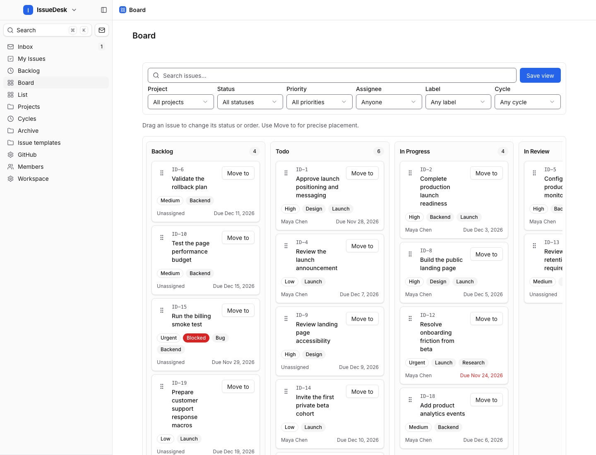

# IssueDesk

A team issue tracker for planning work across boards, projects and cycles.

**Product inspiration:** Linear-inspired issue tracking and project planning, with its own IssueDesk branding.

**Neander library:** IssueDesk · **Category:** Project Management



## What you can build

- Track issues in Backlog, Board, List and My Issues views.
- Plan projects, milestones and cycles with priorities and estimates.
- Connect sub-issues and blocking dependencies; discuss work in comments.
- Use saved views, notifications, attachments and CSV import/export.
- Invite teammates with Admin/Member roles in a workspace of up to ten members.

## How this fits into Neander

This is the open-source app behind Neander’s **IssueDesk** starter. You can
run and modify it on its own without a Neander account, or use it as a starting
point in Neander.

1. Choose **Use Template** in [Neander](https://neander.ai).
2. Neander creates a normal project from a registered version of this repository,
   with fresh Git history, and publishes a working app with sample data.
3. Open the live app and continue in the project. Prompt Neander to make changes
   in the codebase, just as you would in any other project.
4. Use **Publish** again when you want your changes reflected in the live app.

Your project starts from one version. Later changes to this repository or the
template library do not overwrite your project. Linked IDE projects use their
checkout; web projects use Neander’s managed project source.

## Run locally

Stack: Next.js, React, TypeScript, PostgreSQL, Drizzle, Better Auth and dnd-kit.

Use **Node 24.22.3** and **pnpm 11.18.0**. Versions are listed in
`mise.toml`; if you use mise, run `mise install`. Install Docker for the local
PostgreSQL service. Python 3.12 with PyYAML is needed for this repository’s Python checks.

### 1. Install the app

```sh
git clone https://github.com/neanderhq/issuedesk.git
cd issuedesk
pnpm install --frozen-lockfile
cp .env.example .env.local
```

### 2. Start local PostgreSQL

```sh
docker run --detach --name issuedesk-dev-postgres \
  --publish 127.0.0.1:55435:5432 \
  --env POSTGRES_USER=neander_dev --env POSTGRES_PASSWORD=neander_dev_only \
  --env POSTGRES_DB=neander_dev \
  --volume issuedesk-dev-postgres:/var/lib/postgresql/data \
  postgres:16-alpine
```

Wait for PostgreSQL to be ready before the next step:

```sh
docker exec issuedesk-dev-postgres pg_isready -U neander_dev -d neander_dev
```

### 3. Configure the app

Edit `.env.local`. The database URL is already set for the local service above.

| Variable | Purpose |
| --- | --- |
| `DATABASE_URL` | PostgreSQL connection used by this local app. |
| `BETTER_AUTH_URL` | The browser origin, initially `http://127.0.0.1:3000`. |
| `BETTER_AUTH_SECRET` | A random authentication secret. |
| `DEMO_OWNER_PASSWORD` | A password of at least 12 characters for the fictional demo account. |

Generate a value for each blank secret and paste it into the environment file:

```sh
node -e "console.log(require('node:crypto').randomBytes(32).toString('base64url'))"
```

These database credentials are for the loopback development service. Neander
supplies a managed database connection and generated runtime secrets when it
publishes a project. Keep your local environment file out of Git.

### 4. Initialize and start

```sh
node --env-file=.env.local .neander/migrate.mjs
node --env-file=.env.local .neander/seed.mjs
pnpm dev
```

Open **http://127.0.0.1:3000**.

Sign in as **`maya.chen@example.invalid`** with your `DEMO_OWNER_PASSWORD`.

### Try the issue flow

Open **Board**, edit an issue or change its status, then explore **Projects** and **Cycles**. Refresh the page to see the saved changes.

## Sample data

A fictional Product Launch project with 20 issues, five labels, three milestones and three cycles. The initial workspace is named IssueDesk and uses ID- issue keys.

All sample people, organizations and responses are fictional. Seed retries preserve
existing changes and credentials. Normal app restarts do not reset your data.

The app uses one team workspace with invitations. Invitation and password-reset
links are copied by an Admin; email delivery is not configured. Attachments are
stored in PostgreSQL, and live updates use polling.

## Development and checks

```sh
python3.12 -m venv .venv
. .venv/bin/activate
python -m pip install PyYAML==6.0.3
pnpm check
pnpm test
pnpm build
```

Public CI runs these app checks and a production build without Neander’s private
publishing tools or cloud credentials. Full template image/database verification
and library publication are run manually by Neander maintainers in private CI.
Merging a contribution does not automatically update the template library.

## Repository layout

| Path | Purpose |
| --- | --- |
| `app/` | Workspace pages and API routes. |
| `components/` | Issue boards, lists, editors and app shell. |
| `server/` | Authentication, issue/project logic and versioned sample-data initializer. |
| `drizzle/` | Versioned PostgreSQL migrations. |
| `.neander/template.yaml` | Library metadata and install/check/test/seed commands. |
| `.neander/compose.yaml` | Normal Neander Publish recipe and runtime requirements. |
| `.neander/seed.mjs` | Fictional demo initializer. |
| `scripts/verify-template.mjs` | Maintainer verification of the built app image. |

## Maintaining the Neander template

The `.neander/template.yaml` manifest defines the library entry and verification
commands. `.neander/compose.yaml` defines the app’s normal Publish recipe,
including PostgreSQL, migrations and generated secrets. Keep these files in sync
when changing database, authentication or runtime requirements.

Neander’s private release workflow checks out an exact GitHub commit, verifies
the built app with a disposable database, and registers its image and metadata.
The application source stays in this repository.

## Contributing

Fork the repository, make a focused change, and run the checks above before
opening a pull request. Include the behavior you changed and how you verified it.
A maintainer decides when to publish a new version to Neander’s library.

Originally built by Ibrahim on Neander.

## License

[MIT](LICENSE). Third-party components retain their respective licenses and
existing attribution notices.
